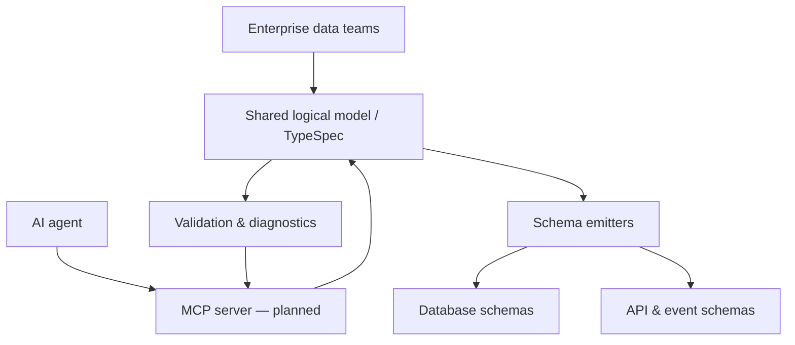

# Super Schema

**Enterprise data modeling for modern data platforms—with an interface designed for AI agents.**

Super Schema is being developed for enterprise teams to define shared logical data models and produce consistent representations across databases, APIs, and event systems. It is designed for modern data platforms, with a planned programmatic interface that also lets AI agents participate in modeling workflows.

**Status:** In development. The standalone source repository, public demo, and planned MCP server are not yet published. This page is the project preview and intended demo outline.

## The problem

A Customer, Product, or Order often has separate definitions in a database, event stream, and API. Maintaining each definition independently creates duplicated work, mismatched types, and schema drift.

The goal is to give enterprise data teams, developers, and AI agents one place to express entity structure and intent, while preserving the semantics that each target platform requires.

## Intended enterprise modeling workflow

1. Inspect an existing logical model or describe a business entity and its enterprise context.
2. Create or refine its fields, relationships, types, and constraints.
3. Validate the model and review diagnostics.
4. Generate the selected platform-specific schemas.
5. Review the generated artifacts and iterate on the shared definition.

Enterprise teams remain the primary users of the modeling workflow. A planned **Model Context Protocol (MCP) server** would expose the same capabilities to AI agents through a programmatic interface. Exact tools, transport, setup commands, and supported clients will be documented with the implementation.

## Planned architecture

This diagram describes the intended design, rather than a released system.

## TypeSpec collaboration

I'm using [Microsoft TypeSpec](https://github.com/microsoft/typespec) as part of Super Schema and collaborating with its open-source community on database-schema generation.

My public proposal explores emitters for PostgreSQL, Spanner, MySQL, BigQuery, Oracle, Iceberg, and Parquet. The discussions address shared decorators, nullability, type mappings, constraints, and database-specific semantics. These are proposed targets; the first release's tested support matrix will be published separately.

[Database-schema emitter proposal](https://github.com/microsoft/typespec/issues/10334) · [Maintainer design discussion](https://github.com/microsoft/typespec/issues/10334#issuecomment-4244266463) · [Super Schema implementation context](https://github.com/microsoft/typespec/issues/10334#issuecomment-5769464100)

## Planned demonstration

**Scenario:** Model a Customer entity with an identifier, optional fields, and business constraints. Show an enterprise developer and an AI agent working with the same logical model to generate representations for two target platforms.

The public demo should show:

- The enterprise modeling task, the agent request, and their shared logical model.
- Validation feedback for a deliberately inconsistent model.
- Generated schemas for the chosen targets, with type-mapping decisions explained.
- A model change propagated to the generated artifacts.
- The distinction between generating schema artifacts and applying changes to a running database.

The runnable example, sample outputs, installation instructions, and recording will be added when ready. Schema migration and deployment behavior must be documented separately if supported.

## Availability

| Resource | Current status |
| --- | --- |
| Standalone repository | Planned location: `github.com/jhsenjaliya/super-schema`; final owner and URL to be confirmed. |
| Runnable demo | Coming later. |
| MCP server | Planned; public setup and tool reference to follow. |
| Tested target matrix | To be published with the implementation. |
| Talk & architectural background | [Super Schema at ODSC](https://odsc.ai/speakers-portfolio/super-schema/). |

[Back to Jay's profile](README.md) · [Publication checklist](PROFILE_TODO.md)
